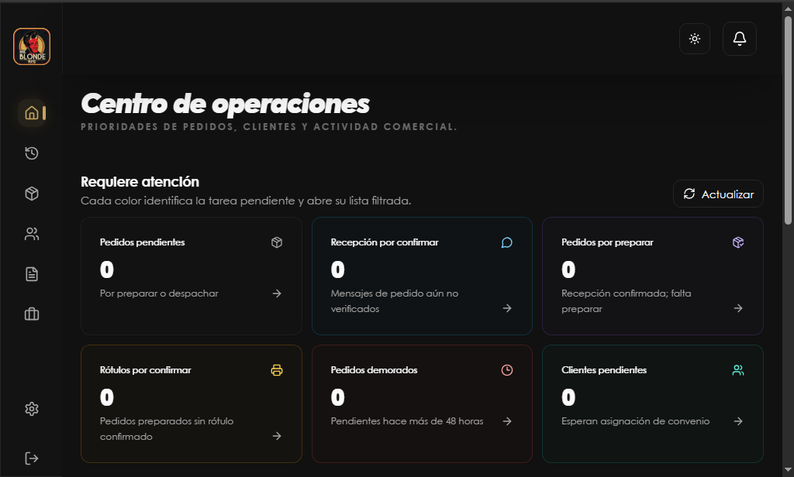
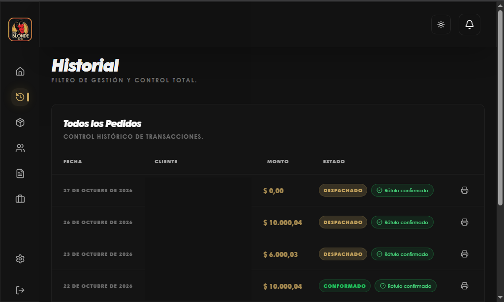
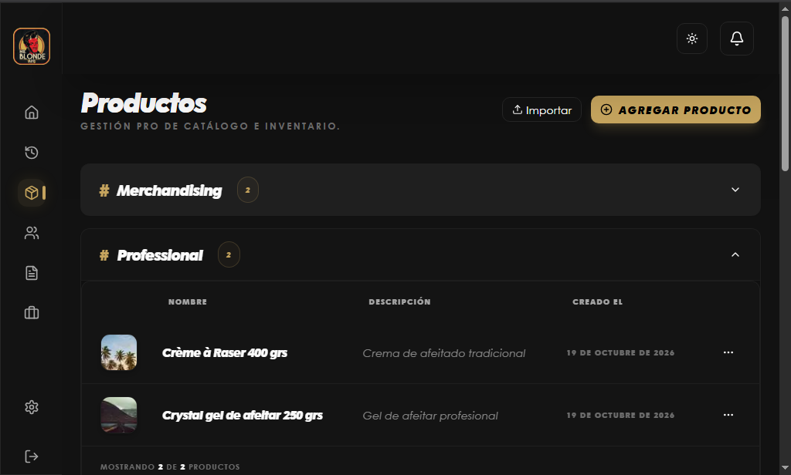
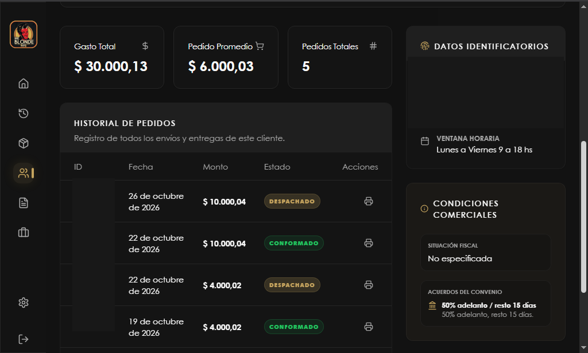
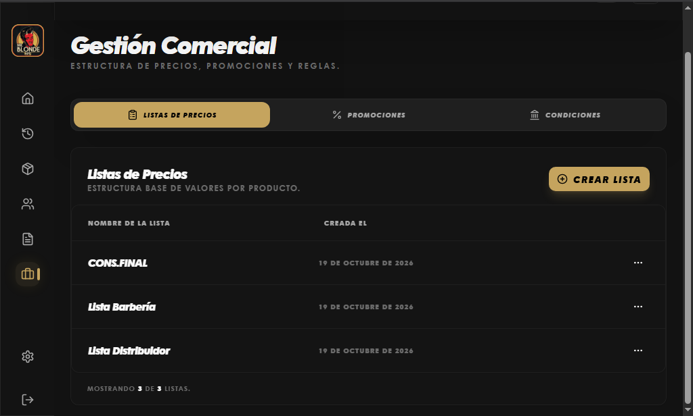
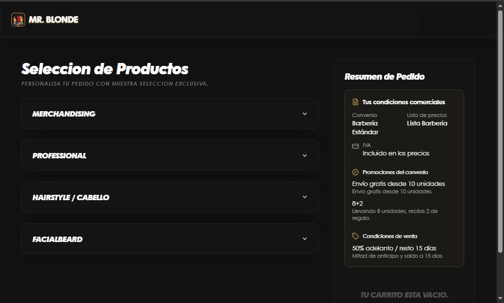
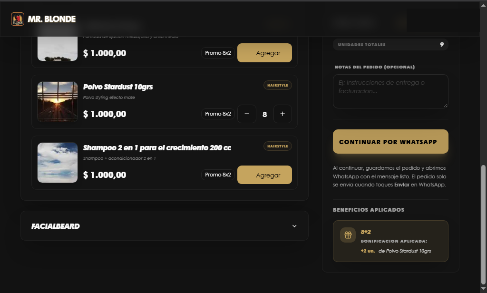
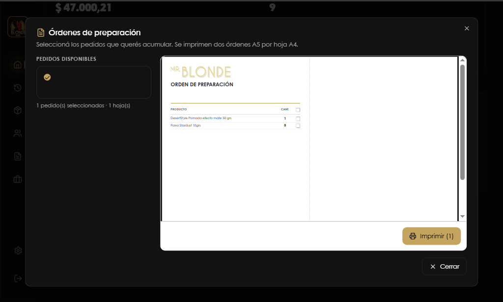
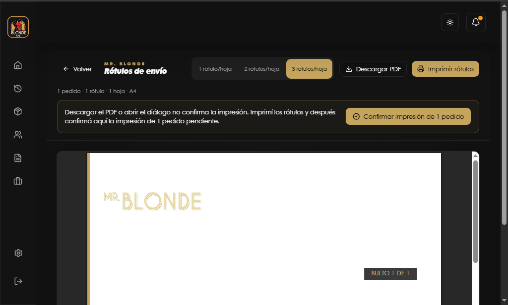

# Blonde Orders (Mr. Blonde)

Sistema moderno de gestión de pedidos B2B diseñado para proveedores de productos de belleza. Enfocado en simplicidad, logística profesional y una experiencia de usuario premium.

## 🌟 Características Principales
- **Dashboard Logístico Pro**: Gestión de pedidos en estados `armado`, `transito` y `entregado`.
- **Rótulos Inteligentes**: Generación de etiquetas PDF con numeración de bultos y códigos QR.
- **Portal de Cliente**: Los clientes pueden confirmar la recepción del pedido escaneando el QR del rótulo.
- **Comandos de IA**: Creación de promociones y listas de precios mediante lenguaje natural.
- **UI Modernizada**: Estética de "Lujo Oscuro" con efectos de cristal (glassmorphism).

## Capturas de pantalla

<table>
  <tr>
    <td width="50%">
      
      
<strong>Centro de operaciones</strong>

    </td>
    <td width="50%">
      
      
<strong>Historial de pedidos</strong>

    </td>
  </tr>
  <tr>
    <td width="50%">
      
      
<strong>Productos</strong>

    </td>
    <td width="50%">
      
      
<strong>Gestión de clientes</strong>

    </td>
  </tr>
  <tr>
    <td width="50%">
      
      
<strong>Gestión comercial</strong>

    </td>
    <td width="50%">
      
      
<strong>Portal de pedidos</strong>

    </td>
  </tr>
  <tr>
    <td width="50%">
      
      
<strong>Carrito y promociones</strong>

    </td>
    <td width="50%">
      
      
<strong>Órdenes de preparación</strong>

    </td>
  </tr>
  <tr>
    <td width="50%">
      
      
<strong>Rótulos de envío</strong>

    </td>
    <td width="50%"></td>
  </tr>
</table>

## 🛠️ Stack Tecnológico
- **Framework**: Next.js 15 (App Router)
- **Base de Datos & Auth**: Supabase
- **Estilos**: Tailwind CSS + shadcn/ui
- **Estado**: Zustand (Carrito de compras)

## Configuración local
Para instrucciones detalladas de instalación, entorno y base de datos, consulta [INSTRUCCIONES.md](./INSTRUCCIONES.md). **No ejecutes el esquema de reconstrucción sobre una base existente.**

## Desarrollo con agentes
Las reglas canónicas para agentes están en [AGENTS.md](./AGENTS.md). También consulta [arquitectura](./ARCHITECTURE.md), [reglas de negocio](./docs/engineering/business-rules.md) y [base de datos y seguridad](./docs/engineering/database.md).

Para validar cambios localmente: `npm run lint`, `npm run typecheck` y `npm test`.

## 📄 Licencia
Este proyecto es un prototipo funcional para Mr. Blonde.